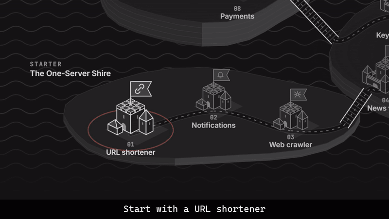

# Systemlands

Learn system design by watching systems break, then building ones that don't.

An interactive platform that simulates and visualizes distributed-system behavior, from a single server to hyperscale designs, in isometric 2.5D.



Live site: https://adarsh0603.github.io/Systemlands/

## Features

- **19 concepts** with live simulations: load balancing, caching, CDN, replication, sharding, consensus, message queues, rate limiting, circuit breakers and more. Most end with a **Build it** puzzle.
- **9 capstones** modeled on real systems (URL shortener, news feed, chat, video streaming, payments, ride sharing). Estimate the load, design, stress-test, compare with a reference.
- Progress saved in the browser, with optional Google sign-in to sync.

## Run it

Requires Node 22.

```sh
npm install
npm run dev
```

Also: `npm run build`, `npm test` (Vitest), `npm run lint`.

## Tech

React 19, TypeScript, Vite, Tailwind CSS 4, SVG, Firebase (auth and sync).
